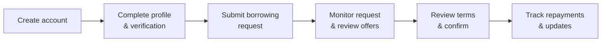
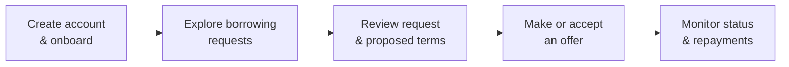

# 🤝 Ngibolekeni

### *Ask to borrow. Offer to lend. Keep it clear.*

A mobile-first peer-to-peer lending platform concept that makes personal borrowing and lending more **accessible**, **transparent** and **accountable**.

---

> [!IMPORTANT]
> **Product status:** This document describes the intended product concept and user experience. It does **not** imply that the platform is already launched, that lending transactions are currently supported, or that any financial, identity-verification or compliance integrations are operational.

## 📑 Table of Contents

- [About](#-about)
- [The Problem](#-the-problem)
- [The Proposed Solution](#-the-proposed-solution)
- [User Roles](#-user-roles)
- [Core Product Areas](#-core-product-areas)
- [Key User Journeys](#-key-user-journeys)
- [Interface & Experience Direction](#-interface--experience-direction)
- [Platform Vision](#-platform-vision)
- [Trust, Safety & Responsible Operation](#-trust-safety--responsible-operation)
- [Product Positioning](#-product-positioning)
- [Disclaimer](#-disclaimer)

---

## 💡 About

Ngibolekeni is a proposed peer-to-peer lending platform that connects people who need financial assistance with individuals who are willing and able to lend. It provides a structured, transparent and user-friendly digital environment where users can discover lending opportunities, submit or review requests, manage agreements and monitor repayment progress.

The name reflects the everyday idea of **asking to borrow**. The product brings that familiar interaction into a digital experience, with clearer processes, better visibility and tools intended to support trust between participants.

## ⚠️ The Problem

Informal borrowing and lending often happens through personal networks and messaging channels. While convenient, these arrangements can suffer from:

- 📝 **Inconsistent records** of what was agreed
- ⏰ **Unclear repayment expectations**
- 👀 **No shared view** of outstanding obligations
- 🔍 **Difficulty finding suitable lenders** for borrowers
- ❓ **Limited information** for lenders assessing a request

Ngibolekeni gives both sides a dedicated place to manage the lending journey.

## ✨ The Proposed Solution

Ngibolekeni brings borrowers and lenders together through a mobile-first platform. Borrowers create and manage requests; lenders review available requests and decide whether to engage. Steps, terms and status are designed to be easy for both parties to understand.

### Guiding Principles

| Principle | What it means |
|---|---|
| 🧭 **Accessibility** | Make the borrowing and lending journey straightforward to navigate. |
| 🔎 **Transparency** | Make request details, agreed terms and repayment status visible to the relevant participants. |
| 🛡️ **Trust & Accountability** | Support appropriate identity checks, documented agreements and clear transaction records as the product and its compliance model are developed. |

## 👥 User Roles

### 🙋 Borrower

A user seeking financial assistance.

- Create a profile and complete the required onboarding steps
- Submit a loan request with amount, purpose and proposed repayment information
- Review the status of submitted requests
- View the details and terms of an offer before accepting it
- Track active borrowing arrangements and repayment progress
- Access a history of previous and current requests

### 💼 Lender

A user considering providing funds to a borrower.

- Create a profile and complete the required onboarding steps
- Browse or review eligible borrowing requests
- View the information made available for assessing a request
- Make or respond to a lending offer, where supported by the agreed product rules
- Review proposed terms before confirming an arrangement
- Monitor active loans, repayment progress and lending history

### 🛠️ Administrator

Supports platform oversight and operational management. Depending on the final operating model, this may include:

- Managing user accounts and access
- Reviewing reported issues and disputes
- Monitoring platform activity and transaction records
- Managing verification outcomes and operational exceptions
- Maintaining platform settings and supporting responsible operations

> [!NOTE]
> Administrative permissions should be **role-based** and restricted to authorised personnel.

## 🧩 Core Product Areas

| Area | Purpose |
|---|---|
| 🚪 **Onboarding & Registration** | Introduce the platform and guide users through account creation. |
| 🪪 **Identity & Document Verification** | Support identity checks and document submission, subject to the selected verification provider and compliance requirements. |
| 📊 **User Dashboard** | Give each user a clear overview of relevant activity and outstanding actions. |
| 🙋 **Borrower Experience** | Create requests, review offers and manage borrowing arrangements. |
| 💼 **Lender Experience** | Discover requests, assess available information and manage lending activity. |
| 📄 **Loan Details** | Present the agreed amount, terms, dates and status of an arrangement. |
| 📈 **Repayment Tracking** | Show repayment schedules, recorded payments and outstanding balances. |
| 🔔 **Notifications** | Keep users informed about relevant updates and actions. |
| 🛠️ **Administration** | Provide authorised operators with tools for platform oversight and support. |

> These are intended product capabilities. The exact feature set, payment flows, verification provider and operational rules remain subject to product, technical and regulatory decisions.

## 🗺️ Key User Journeys

### Borrowing Journey

1. Open Ngibolekeni and create an account.
2. Complete the required profile and verification steps.
3. Submit a borrowing request.
4. Monitor the request and review any offers received.
5. Review the proposed terms and confirm whether to proceed.
6. Once active, track repayment information and receive relevant updates.

### Lending Journey

1. Create an account and complete the required onboarding steps.
2. Explore borrowing requests made available to lenders.
3. Review the request information and proposed terms.
4. Choose whether to make or accept an offer, according to the platform's rules.
5. Once confirmed, monitor the arrangement's status and repayment progress.

### Account & Support Journey

Users should be able to manage their profile, review relevant activity, receive important notifications and find a clear route to report a problem or request assistance.

## 🎨 Interface & Experience Direction

Ngibolekeni is intended to have a **clean, minimal and accessible** interface. The experience should feel approachable without making financial activity feel casual or unclear.

### Colour Palette: Oxford Blue

| Swatch | Name | Hex |
|:---:|---|---|
|  | Deep Navy | `#051729` |
|  | Dark Blue | `#08223B` |
|  | Secondary Navy | `#092541` |
|  | Medium Blue | `#0F4373` |
|  | Accent Blue | `#1A77CD` |
|  | White & restrained neutrals | Contrast and readability |

### Brand Mark

An **abstract hands motif** communicates giving and receiving. The mark stays minimal, using a simple outline treatment rather than detailed illustrations or human figures.

### Design Priorities

- ✅ Clear navigation and recognisable actions
- ✅ Readable loan amounts, dates and status indicators
- ✅ Consistent layouts across mobile screens and responsive web views
- ✅ Accessible colour contrast and legible typography
- ✅ Clear confirmation steps for consequential actions
- ✅ Helpful empty, loading, error and success states
- ✅ Plain-language explanations of financial terms and user responsibilities

## 📱 Platform Vision

Ngibolekeni is being considered as a cross-platform experience:

| Platform | Approach |
|---|---|
| 📱 **Mobile** | Flutter-based application |
| 🌐 **Web** | Responsive web experience |

The interface should be consistent across form factors while making sensible use of each screen size. The vision is a dependable digital environment for person-to-person lending, where users can understand the process, make informed decisions and keep a reliable record of their arrangements.

## 🔐 Trust, Safety & Responsible Operation

Because Ngibolekeni concerns financial arrangements between people, trust and responsible operation are central. Before the platform facilitates real lending or payment activity, its operating model will need to address, among other matters:

- ⚖️ Applicable financial-services, lending, consumer-protection and data-protection requirements in each target market
- 🏛️ The platform's legal role in the lending relationship
- 🪪 Identity verification and fraud prevention
- 📉 How affordability, risk and eligibility are assessed, if applicable
- 💬 Clear disclosure of fees, interest, repayment obligations and consequences of non-payment
- 🔒 Secure handling of personal information and documents
- 💳 Payment processing, reconciliation, refunds and dispute handling
- 🎧 Complaints, customer support and record retention

> [!WARNING]
> The app must not imply that a borrower is guaranteed funding or that a lender is guaranteed repayment. Any risk indicators or verification results should be explained accurately and not presented as guarantees.

## 🎯 Product Positioning

Ngibolekeni is a peer-to-peer lending platform concept that aims to make personal borrowing and lending more organised, transparent and accessible. It is designed to connect people, structure the steps involved in a lending arrangement and give participants a shared view of requests, agreed terms and repayment activity.

**In short:** a mobile-first peer-to-peer lending app concept that connects people seeking financial assistance with individuals willing to lend, supporting onboarding, loan requests and offers, documented terms, repayment tracking and clear account dashboards in a simple, transparent experience.

## 📜 Disclaimer

This description is a product overview, **not** a financial promotion, lending offer or statement of regulatory approval. Final functionality and launch readiness depend on technical implementation, operational design and applicable legal and compliance review.

---

**Ngibolekeni** · *Borrowing and lending, made clear.*

